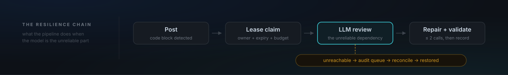
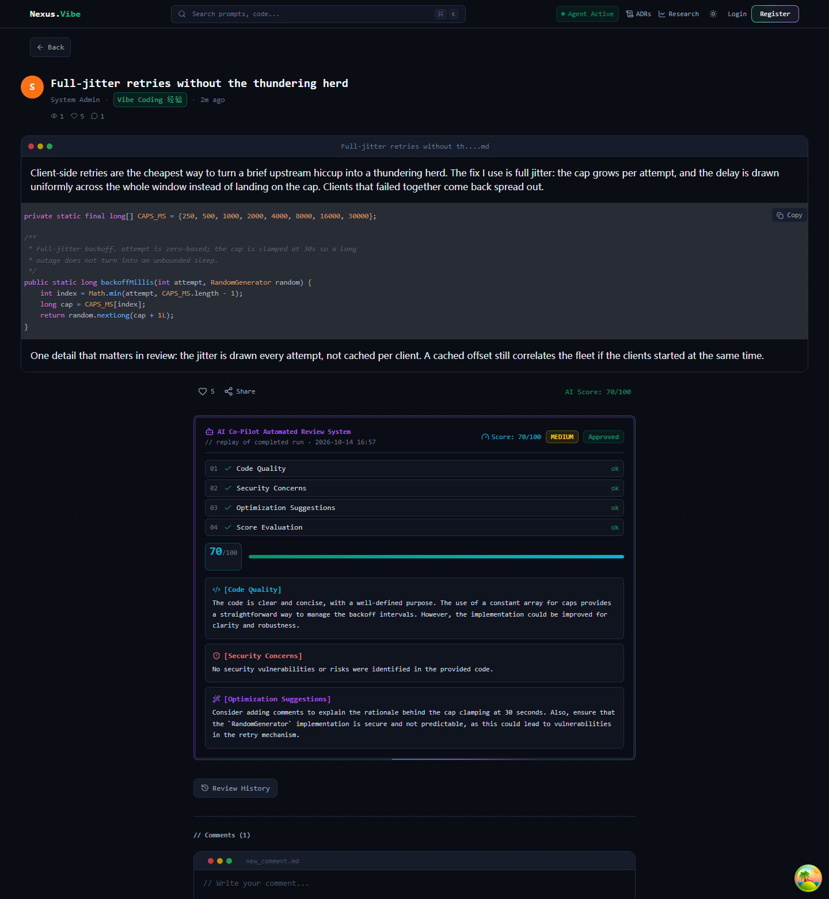
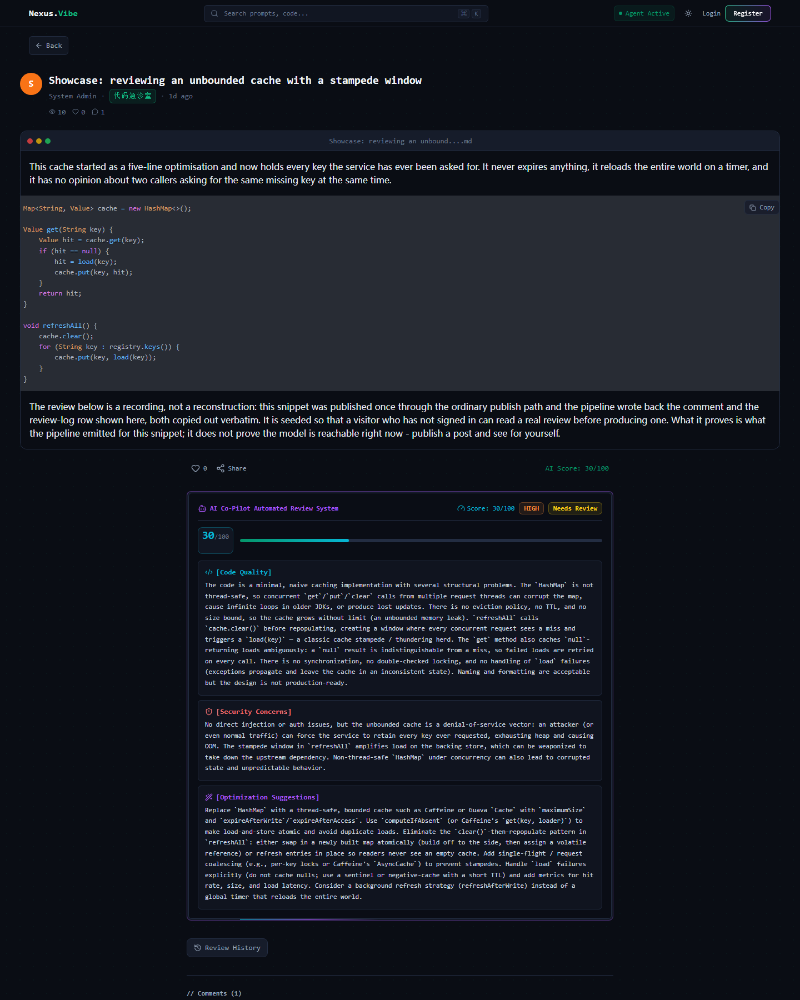
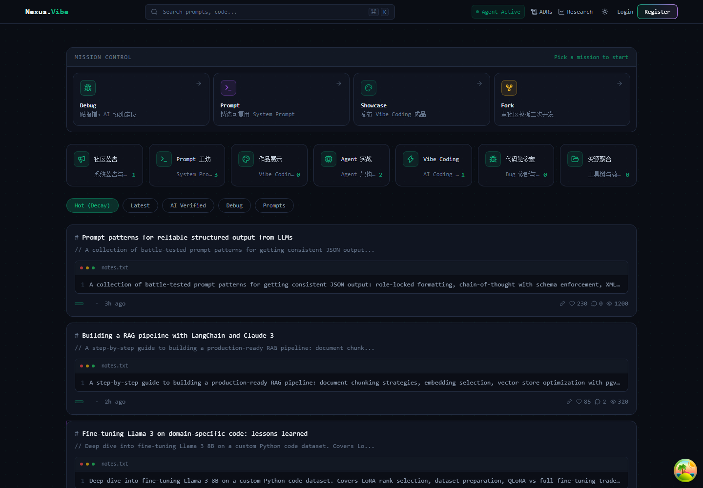
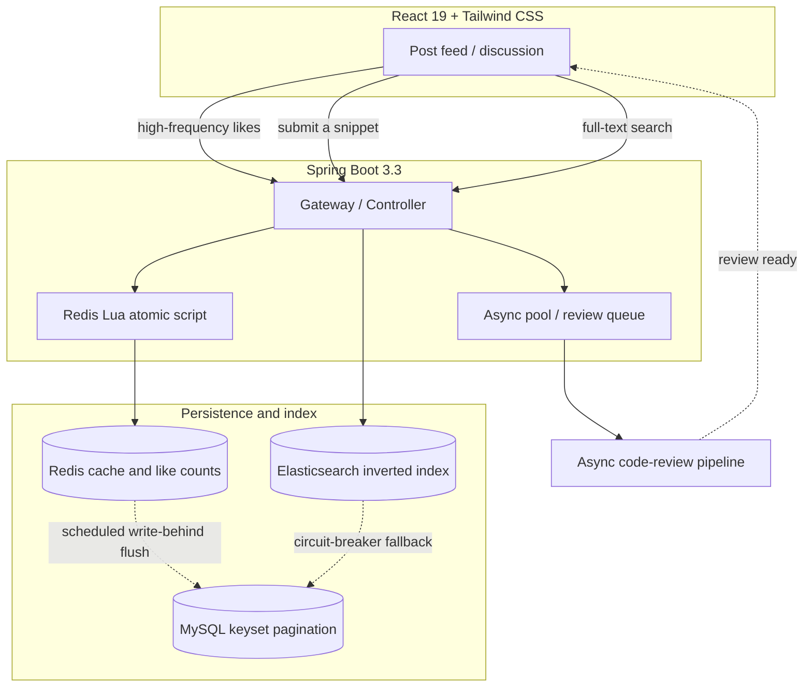
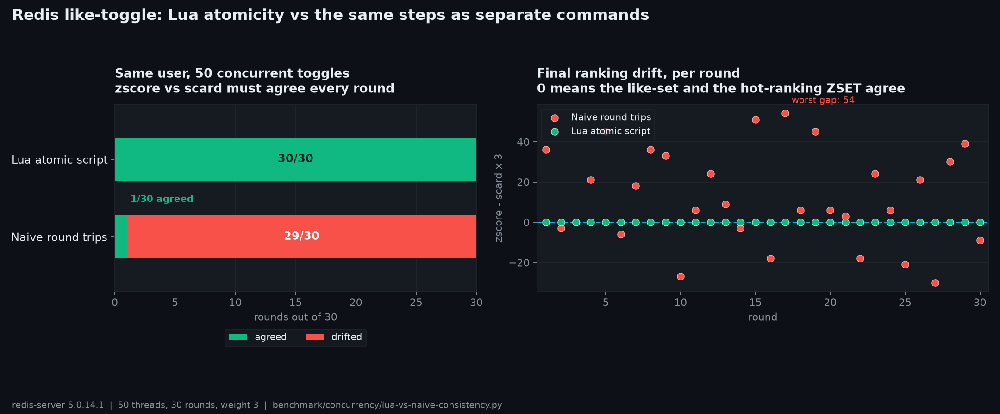

<a name="top"></a>

<h1 align="center">Nexus-Vibe</h1>

<p align="center"><b>A full-stack AI developer community whose subject is treating an LLM as an unreliable dependency.</b></p>

<p align="center">
  <a href="https://github.com/shing26/nexus-vibe/actions"></a>
  
  
  
  
  <a href="LICENSE"></a>
</p>

<p align="center">
  <a href="https://qualifier-discuss-marry.ngrok-free.dev"><b>Live demo</b></a> ·
  <a href="#run-it-in-three-minutes"><b>Run locally</b></a> ·
  <a href="#fork-map"><b>Fork map</b></a> ·
  <a href="#evidence-wall"><b>Evidence wall</b></a> ·
  <a href="docs/INDEX.md"><b>Docs index</b></a>
</p>

<p align="center"></p>

<p align="center">One compose file, two pipeline seams, and a review terminal whose steps are a data file.<br><b>Built to be forked.</b></p>

<p align="center"></p>

*One real run, not a mock-up.* This post was published to a local dev stack on 2026-10-14 and
reviewed by `qwen2.5:7b` through Ollama; the terminal replays the stored result - the four steps
light in order, then the score counts itself in
([ADR-0010](docs/adr/0010-the-showcase-review-is-a-recording.md)). The likes next to it are real
too: five demo accounts toggled the post through the like endpoint.

## 📖 What this is

A modern team/campus forum - Markdown posts, channels, threaded comments, prompt-template
forking, per-user workspaces - with an AI-governed content pipeline wrapped around it. The
code that matters is the failure handling around the model:

- Posts containing code blocks are reviewed **asynchronously**, with structured output
  (score, quality, security, suggestions) that is repair-parsed and semantically validated
  before it may be recorded at all.
- An unreachable model **fails closed**: new posts wait in the audit queue instead of
  publishing unreviewed, and the health endpoint says DEGRADED, not dead.
- Reviews are claimed by a **lease** - two workers can never process one post, and a
  crashed worker's task is re-dispatched by reconciliation rather than lost.
- Every number in this README names the run that produced it.

## 🌐 Live demo

**<https://qualifier-discuss-marry.ngrok-free.dev>** - no account needed. The home page links
one already-reviewed post, and `/post/900000000000000001` renders an AI review recorded from
a real pipeline run - score, severity, verdict, findings. On the post page the finished
review **replays its steps in order**: the finding sections confirm one by one, then the
score counts itself in. [ADR-0010](docs/adr/0010-the-showcase-review-is-a-recording.md)
records why it is a recording of one real run rather than a live feed, and
`benchmark/showcase/` holds the script that produced it, so the claim is reproducible
rather than asserted.

<p align="center"></p>

Two things to know before you click:

- ngrok's free tier shows a one-time "Visit Site" warning page the first time a browser
  sees the domain. It is not part of this project; one click dismisses it for seven days.
- It is a single home machine. If it is asleep the address stops answering, and every
  piece of evidence below was measured on the same class of machine rather than in a cloud
  region.

<a name="run-it-in-three-minutes"></a>

## 🚀 Run it in three minutes

Three paths, each with its own port. Prerequisites: Docker with Compose v2 for path A;
JDK 18+ and Maven 3.9+ (plus Node.js 22+) for path B. There is no `mvnw` wrapper - the
command is `mvn`.

### A. Full stack, one command (recommended)

```bash
cp .env.example .env
# fill the four blanks: DB_PASSWORD, MYSQL_ROOT_PASSWORD, JWT_SECRET, BOOTSTRAP_ADMIN_PASSWORD
# (APP_TAG=dev ships in the example and is required: an anonymous build has no rollback target)
docker compose up -d --build
```

Open **http://localhost:8080** - `WEB_PORT` is the only port the stack publishes. The first
run builds the `app` and `web` images and takes a few minutes; CI builds the same
Dockerfiles on every pull request. The AI pipeline needs one model pulled into the
compose-local Ollama:

```bash
docker compose exec ollama ollama pull qwen2.5:3b   # qwen2.5:7b if you have the compute
```

**Model quality bar.** The review agent validates output semantically: schema-valid but
empty or placeholder responses - common from local 7B/3B models - are retried once, then
degrade silently (logged `unknown`, no score, no AI comment). Until a model is pulled, or
while the endpoint is unreachable, the safety check fails closed and new posts wait in the
audit queue rather than publishing unreviewed. Local models exercise the pipeline; for
reviews you can actually use, point `LLM_ENDPOINT` at a hosted model.

### B. Local development

```bash
mvn spring-boot:run   # backend on :8081, H2 in-memory, schema and seed auto-created
cd frontend && npm install && npm run dev   # SPA on :5173, /api proxied to :8081
```

No middleware needed: the dev profile runs on H2 with Redis off, and search degrades to
the MySQL path when Elasticsearch is unreachable. Dev mode seeds `admin / 123456` (plus
`shing` and `alice`) into the in-memory database - a development convenience, not a
deployment feature; the compose stack never has it.

### C. A forum with no model at all

No API key, no Ollama, no model download. Add two lines to `.env` before `up -d --build`:

```bash
AI_REVIEW_ENABLED=false
AI_SAFETY_ENABLED=false
```

With both switches off, the forum posts, comments and likes normally and nothing calls a
model - a documented state, not a hack. The switches are independent: review off stops
code-review comments and scores; safety off stops the LLM classification and its
fail-closed queueing.

### About the accounts

There is no `admin / Admin@123456`, and there is no mock login. A deployment with seeding
off - the production default, `DEMO_SEED_ENABLED=false` - holds **no** demo accounts and
**no** sample posts; the one administrator comes from `BOOTSTRAP_ADMIN_PASSWORD`, created
once while the database has no `ADMIN`
([ADR-0008](docs/adr/0008-bootstrap-admin-and-empty-production-seed.md)). Rotate it after
logging in. For a throwaway demo instance, `DEMO_SEED_ENABLED=true` with `DEMO_PASSWORD`
seeds accounts and sample content - never in production.

## 📦 What you get

<p align="center"></p>

**The forum.** Registration and JWT auth with unique-email recovery, Markdown posts with
live preview, channel browsing with slug routing, threaded comments, prompt-template
forking with version history and rollback, per-user profile workspace with an activity
timeline, and an admin audit dashboard with assisted account recovery.

**The AI pipeline.** Posts containing code blocks are reviewed asynchronously with
structured output and a visible rubric; fenced output, truncation and trailing commas are
repair-parsed, and unparseable output is retried with the parser error so a review stays
within two model calls; a second listener classifies content into four safety classes;
editing a post re-triggers the review and supersedes the stale comment; the whole run
history is queryable with severity stats and filters.

**The parts that carry the thesis.** Redis Lua like toggle with write-behind flush and
hourly drift reconciliation, sliding-window rate limiting, DFA sensitive-word filtering
with hot reload, gravity-decay hot ranking, lease-based review claims with an attempt
budget and a terminal notification, a dedicated agent pool that turns a saturated dispatch
into a retryable state instead of failing the request, and an IDE-station dark UI whose
motion work collapses under `prefers-reduced-motion`.

<a name="fork-map"></a>

## 🧩 Adapting it - the fork map

[ADR-0012](docs/adr/0012-the-review-pipeline-is-pluggable-at-two-seams.md) publishes
exactly two seams, and everything the seams are not stays fixed.

- **`ReviewPolicy` - should this post be reviewed?** One method,
  `boolean shouldReview(VibePost post)`, resolved as a Spring bean with
  `@ConditionalOnMissingBean`; the default `CodeBlockReviewPolicy` is today's
  fenced-code-block rule. Define your own bean and it is the rule, without editing a core
  file:

```java
package com.nexus.campus.agent;

import com.nexus.campus.entity.VibePost;
import org.springframework.stereotype.Component;

@Component
public class PromptOnlyReviewPolicy implements ReviewPolicy {
    @Override
    public boolean shouldReview(VibePost post) {
        return "prompt".equals(post.getPostType());
    }
}
```

- **`Reviewer` - who produces the verdict?** Decided in ADR-0012 as a verdict object plus
  a default `LlmReviewer` bean, and **not yet in the tree**: no `Reviewer` interface exists
  in `src/main/java` today - the producing half still sits inside `AiReviewService`, and
  the split is tracked as AI-2 in
  [docs/tickets/ai-review-seam.md](docs/tickets/ai-review-seam.md), status open. This line
  changes in the commit that lands it.

**What is deliberately not a seam:** the lease claim
([ADR-0005](docs/adr/0005-lease-based-review-claim.md)), the reconciliation task,
fail-closed moderation ([ADR-0004](docs/adr/0004-safety-check-fail-closed.md)), the
terminal notification when the attempt budget runs out, and review validity - the
semantic check that decides whether a model's output may be recorded at all. These are the
thesis; a pipeline that let a fork switch them off would delete the reason this repository
exists.

**Swapping the model** is three environment variables - `LLM_ENDPOINT`, `LLM_MODEL`,
`LLM_API_KEY` - bound under `campus.ai.llm.*`
([ADR-0013](docs/adr/0013-config-validation-moves-to-validated-properties.md)). Any
OpenAI-compatible chat-completions endpoint works, including a local Ollama
(`http://localhost:11434/v1`, any non-empty key); a provider that rejects strict JSON
schemas degrades into the plain-completion fallback instead of failing, and
`AI_RESPONSE_FORMAT` picks `json_schema` / `json_object` / `none` per provider.

**The review beats in the UI are data.**
[reviewSteps.ts](frontend/src/components/ui/reviewSteps.ts) holds the four steps the
terminal replays, `ReviewStepStrip.tsx` renders the strip, and `AiReviewTerminal.tsx`
owns the replay. Changing labels, icons or order is a frontend-only edit; a genuinely new
assessment dimension needs a backend field as well, because each of the first three steps
names a field of `AiReviewDetail`.

**Running with no review at all** is a supported configuration - path C above.

## 🏗️ Architecture



Behind the picture: `AiReviewEvent` → `LlmClient` (OpenAI-compatible) → repair-parse →
semantic validation → review log + auto-comment + score writeback. A second listener runs the
four-class fail-closed moderation, and the reconciliation task sweeps lease expiry, `FAILED`
and `pending-llm` posts.

**Resilience chain** (every link below was verified with fault injection):

- **Lease-based claims**: an AI review starts with an atomic conditional UPDATE - concurrent instances or re-published events cannot double-process a post; after 5 failed attempts the author is notified once and re-dispatch stops
- **Fail-closed moderation**: LLM unreachable → new posts enter the audit queue with a `pending-llm` marker; the reconciliation task re-checks them when the LLM recovers and restores Safe posts
- **Semantic validation + self-correction**: schema-valid garbage (placeholder fields from small local models) retries with a reinforced prompt; *unparseable* output (fences, trailing commas, max-token truncation) is repair-parsed, then retried with the model's own output plus the parser error - total LLM calls per review stay ≤ 2
- **Pool isolation**: LLM-bound listeners run on a dedicated small pool (core2/max4, Abort) so model latency can never starve message/notification work
- **Count drift reconciliation**: hourly rotating-cursor sweep unions Redis membership with the durable `vibe_post_like` table, repairs either side without deleting members, and rebuilds the hot-ranking ZSET when anything changed
- **Graceful saturation**: agent events rejected by a saturated pool degrade the post to a retryable state instead of failing the request (verified under a 50-concurrent load: 121k rejections, zero crashes)

### Why the like toggle is one Lua script

A like is three Redis structures that must agree: the member set, the dirty marker and the
hot-ranking ZSET. `like_toggle.lua` mutates them in one atomic script. The same steps sent as
separate commands have a window between `SISMEMBER` and `SADD`, so two callers can both read
"not liked", both write, and both credit the ranking - one member, two weights.

`benchmark/concurrency/lua-vs-naive-consistency.py` runs the shipped
[`like_toggle.lua`](src/main/resources/lua/like_toggle.lua) against that control, both under 50
concurrent threads. The invariant is `zscore == scard * weight`; a round that breaks it is a
round where the two structures disagree about the same like.

<p align="center"></p>

*Redis-only probe against a standalone redis-server 5.0.14.1 (not the compose stack); 50 threads,
30 rounds, weight 3. Data in `benchmark/concurrency/results/lua-vs-naive-20261014.{json,md}`, redrawn
by `render-lua-consistency-chart.py`. The naive path is a control, not code the application ships,
and the report lists what the probe cannot prove.*

<a name="evidence-wall"></a>

## 📊 The evidence wall

Every number in this section was measured on this repository's own stack, and each report
names the command that produced it. The drill report ends with a list of what it cannot
prove - that habit is kept on purpose.

| Evidence | What it shows |
|---|---|
| [Async pool load test](docs/research/async-pool-loadtest.md) | 25,204 samples from the reproducible 2026-09-21 run: 13 errors (0.1%), p50/p90/p99 37/1,770/3,353 ms, 6,231 posts left FAILED(3), zero crashes; where the pipeline actually saturates |
| [Container GC analysis](docs/research/jvm-container-gc-analysis.md) | 768 MB container, 0 full GCs, and why `MaxRAMPercentage=75` is the right ceiling |
| [Deep pagination](docs/research/late-row-lookup-deep-pagination.md) | A delayed-join optimisation measured 40% *slower* and was rolled back - with the EXPLAIN output kept |
| [Observability drill](docs/research/observability-drill-2026-09.md) | 23 scripted failure injections against the real stack, including what the drill cannot prove |
| [Technical blog](docs/blog/llm-code-review-structured-output-injection-defense.md) | How the structured-output review survives injection attempts and malformed model output |

The decisions behind all of it: **[fifteen ADRs, 0001-0015](docs/adr/)** - fail-closed
moderation, lease-based claims, degraded-is-not-unhealthy, the recording discipline, the
two seams, metrics and rules.

Where to look, in the time you have:

- **30 seconds** - the live demo above: one real review of one real snippet, without registering.
- **10 minutes** - the three decisions the pipeline is built around:
  [fail-closed moderation](docs/adr/0004-safety-check-fail-closed.md),
  [lease-based claims](docs/adr/0005-lease-based-review-claim.md),
  [degraded is not unhealthy](docs/adr/0007-degraded-status-is-not-unhealthy.md).
- **90 minutes** - the table above, in the order it was produced.

## 🛠️ Tech stack

| Layer | Technology |
|-------|-----------|
| **Backend** | Spring Boot 3.3.5, Java 18 |
| **ORM** | MyBatis-Plus 3.5.9 |
| **Frontend** | React 19 + Vite + TypeScript + Tailwind CSS |
| **State** | TanStack Query + Zustand |
| **Database** | H2 (dev) / MySQL 8 (prod) |
| **Cache** | Redis 7 (Lettuce) - atomic Lua like toggle, rate limiting, hot ranking |
| **Search** | Elasticsearch 7.17 (MySQL fallback) |
| **LLM** | OpenAI-compatible API / local Ollama |
| **Auth** | JWT (jjwt 0.12.6) + BCrypt |
| **Observability** | Prometheus + Grafana + alert-bridge (monitoring profile) |
| **Build** | Maven 3.9+ + Vite, multi-stage Docker, GitHub Actions CI |

## ⚙️ Configuration quick reference

The full list lives in [.env.example](.env.example), one comment per variable, and
[docs/plans/environment-matrix.md](docs/plans/environment-matrix.md) carries the dev /
prod / CI values for each. These are the ones a first run touches.

<details>
<summary><b>Expand the 12 variables a first run touches</b></summary>

| Variable | Default | Purpose |
|----------|---------|---------|
| `WEB_PORT` | `8080` | the only port the stack publishes |
| `APP_TAG` | required (ships `dev`) | release identity stamped on both images; bump to release, revert to roll back |
| `DB_URL` / `DB_USERNAME` / `DB_PASSWORD` | compose-internal | MySQL application connection (use `nexus_app`, not `root`) |
| `MYSQL_ROOT_PASSWORD` | required | MySQL root password, used only for initialization and maintenance |
| `JWT_SECRET` | empty | JWT signing secret (required in prod, fail-fast) |
| `BOOTSTRAP_ADMIN_PASSWORD` | empty | Creates `admin` once, only while no `ADMIN` exists and seeding is off |
| `DEMO_SEED_ENABLED` / `DEMO_PASSWORD` | `false` | Opt-in demo accounts and sample content for a throwaway instance |
| `CORS_ALLOWED_ORIGINS` | localhost + the live domain | Allowed browser origins - a pair with the tunnel address, always changed together |
| `LLM_ENDPOINT` / `LLM_MODEL` / `LLM_API_KEY` | compose-local Ollama, `qwen2.5:7b` | Any OpenAI-compatible endpoint; the key is only for hosted APIs |
| `AI_REVIEW_ENABLED` / `AI_SAFETY_ENABLED` | `true` / `true` | Independent switches; both off is path C |
| `AI_LEASE_SECONDS` / `AI_MAX_ATTEMPTS` | `240` / `5` | Lease window and retry budget |
| `REDIS_ENABLED` | `true` | Off sends likes, rate limiting and ranking down the MySQL fallback path |

</details>

## 🔭 Observability

Three layers - logs, metrics, alerts - and none of them opens a public port.

- **Logs**: `docker logs` plus the `app-logs` volume at `/app/logs`; prod writes
  structured JSON to disk (rotated, capped), and one 16-hex `traceId` per request crosses
  thread pools and scheduled tasks.
- **Metrics**: `GET /actuator/prometheus`, compose-internal only - JVM / HTTP plus the AI
  link's own numbers: `llm_chat_completions_total{outcome}`,
  `llm_chat_completion_duration_seconds`, `llm_circuit_breaker_open`,
  `rate_limit_rejected_total{path}`, `ai_review_pending_posts`,
  `ai_review_reconcile_repairs_total{kind}`, and the agent pipeline's own
  `agent_pool_rejected_{review,safety}_total` / `agent_fail_closed_total` /
  `safety_pending_posts` ([ADR-0015](docs/adr/0015-the-agent-pipeline-gets-metrics-and-rules.md)).
- **Alerts**: nine versioned Grafana rules -> `alert-bridge` -> a Feishu bot; webhook and
  signing secret live in `.env` only. The six-step walkthrough, the error-code table and
  the contact-point check are in
  [docs/runbook/feishu-alerting.md](docs/runbook/feishu-alerting.md).

Health is two-layered
([ADR-0007](docs/adr/0007-degraded-status-is-not-unhealthy.md)): the public
`/actuator/health` answers through nginx's `servable` group and only reports what a
visitor can still use - only the storage layer can mark it DOWN. The container's own
healthcheck asks the aggregate state: Redis, Elasticsearch or the LLM dropping out is
`DEGRADED` with HTTP 200, never a kill.

The monitoring stack rides a profile, so a plain `docker compose up` never starts it:

```bash
docker compose --profile monitoring up -d
```

The 23-step drill is reproduced by `benchmark/observability/drill.ps1` against an isolated
compose project; its report is
[the drill](docs/research/observability-drill-2026-09.md). Release, rollback, backup and
the live-instance notes live in
[docs/runbook/release-and-live-instance.md](docs/runbook/release-and-live-instance.md);
the restore rehearsal is [docs/runbook/restore.md](docs/runbook/restore.md).

## 🧪 Testing gates

Measured 2026-10-14 on this machine: backend **417 tests / 70 classes**, 0 failures, 0
errors, 0 skipped - counted from one `mvn -B test` summary line, never
`target/surefire-reports/`, which accumulates runs and lies. Frontend **42 tests / 11
files**: the axios response interceptor (a 401 replayed once against the refreshed token,
one refresh shared across concurrent 401s, a refused refresh that logs out without
looping, a 5xx named with its trace id), the server-error sentence mapping, the login
page's server reason, the AI review panel (a stored 0-10 shown as the 0-100 it claims, a
stored zero as an empty meter rather than NaN, the replay that lights the steps in
order), reduced motion, the mobile tab bar, the nav evidence links, the comment body,
the showcase entry, the step strip, and the call-site scan. The alert bridge carries
**28** Python tests.

Coverage is a gate, not a report: `pom.xml` pins `jacoco.line.minimum` to 0.70 for the
whole bundle (first measured 74.27%; the 2026-10-14 run measured 74.83% - 3,018 of 4,033
lines, from `target/site/jacoco/jacoco.csv`), and `mvn test` fails below it. When you
squeeze surefire's `-DargLine` to fit a smaller heap, pass `-Djacoco.skip=true` with it -
`-DargLine=` replaces the JaCoCo agent arguments instead of appending, coverage silently
measures 0.00, and the floor fails the build on a number that was never real.

Four contract checks read the source: no entity in a controller signature, no MyBatis type
in a repository interface, frontend `types/` fields matching the DTOs' Jackson types, and
no test pairing `isOk()` with a non-200 code; a fifth scan requires every frontend
`apiClient.` call to sit inside a `try`/`catch` or react-query.

```bash
mvn test                      # 417: unit + H2 integration + the source-scanning contract checks + the JaCoCo floor
cd frontend && npm run build  # tsc strict, zero @ts-ignore
cd frontend && npm run lint   # oxlint
cd frontend && npm run test   # 42
cd docker/observability/alert-bridge && python -m unittest -v test_alert_bridge   # 28
```

CI (`.github/workflows/maven.yml`) runs all of the above plus the `app` and `web` image
builds.

## 📁 Repository structure

<details>
<summary><b>Expand the tree</b></summary>

```
nexus-vibe/
frontend/                        # React 19 SPA (Vite + TypeScript + Tailwind)
  src/components/                 # AiReviewTerminal, ui/ReviewStepStrip, Navbar, ...
  src/components/ui/reviewSteps.ts  # the beats the terminal is allowed to name
  src/pages/ src/api/ src/stores/ src/types/ src/test/
  src/links.ts                    # the navbar/footer evidence links (ADRs, load test, drill)
src/main/java/com/nexus/campus/  # the package kept the pre-rename domain word (ADR-0001)
  agent/                          # LLM client, repair-parse, review + safety listeners, ReviewPolicy
  task/                           # reconciliation, drift, like-sync, funnels
  filter/ config/                 # XSS wrapper, trace id, dual pools, security, health indicators
  controller/ service/ repository/ entity/ dto/ mapper/ metrics/ ...
docker/
  mysql/                          # init.sql + one-shot migrations and rollbacks + the 100k-row harness
  nginx/                          # the only published port: ${WEB_PORT:-8080} -> 80
  observability/                  # Prometheus + Grafana provisioning + the Feishu alert bridge
benchmark/                        # jmeter / concurrency / migrations / observability / showcase
scripts/                          # backup, tunnel, rate-limit probe
docs/                             # ADRs, research, tickets, plans, runbooks, blog
docker-compose.yml                # the only compose file at the root; variants live under benchmark/
CONTEXT.md  CHANGELOG.md  AGENTS.md
```

</details>

The package is `com.nexus.campus` while the product is Nexus-Vibe: ADR-0001 renamed the
domain entities to Vibe names and deliberately left the package, so the history reads
straight.

## 🤝 Contributing

Fork, branch, keep the gates green, open a pull request - in this repository, on a
`codex/<slug>` branch rather than `master`. Read [AGENTS.md](AGENTS.md) for the working
contract and [CONTEXT.md](CONTEXT.md) for the vocabulary; [docs/INDEX.md](docs/INDEX.md)
maps every document, and a document that is not in it is a document nobody will find. ADRs
are append-only and numbered sequentially: a changed mind means a new ADR, never an edit.
One rule outlives the others - a claim without a reproducible path does not go in.

## 📄 License

This project is licensed under the MIT License. See [LICENSE](LICENSE).

---

<p align="center"><sub>Java 18 · Spring Boot 3.3.5 · React 19 · MySQL · Redis · Elasticsearch — and one unreliable LLM</sub></p>

<p align="center"><a href="#top">Back to top</a></p>
